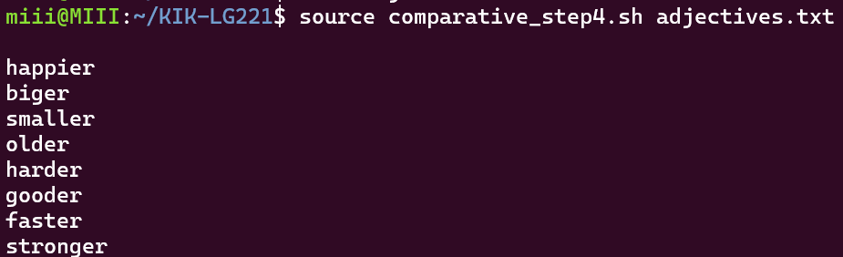

## **Command Line Tools for Linguists** - Course Introduction

The Command Line Tools for Linguists-course is an introduction to the basics of working on UNIX-based systems and using the 
command line tools most useful for linguistic applications. 

#### This course covers the introductory basics of the following topics:

* setting up and using a UNIX-like environment
* common command-line tools
* text manipulation and data processing
* use of remote servers and compute infrastructure
* installing and running programs from the command-line on local computers and remote servers
* script development and version control tools
* web page development

## **Module 1**: Introduction to Command Line Environments

The first module introduces the UNIX system and covers installing a command line environment for Windows/Mac/Linux. 
Also introduced are basic commands, terminal-based text editors and the UNIX file system, including file and directory permissions, 
to start working in the command line.

This module was quite information dense as a first introduction to UNIX and command line tools, but the Moodle quiz/exercises 
demonstrated clearly how things work in practice and I do feel like I got well acquainted with the most basic commands.

#### Some useful commands from the first module:

command | explanation
--- | ---
`ls` | *lists files and directories*
`pwd` | *tells you your current location*
`cd` | *changes directories*
`cd ..` | *”one level up”*
`cp` | *copy*
`mv` | *move (/rename)*
`mkdir` | *make directory*
`rm` | *remove*
`touch` | *creates a new file*
`cat` | *concatenate files, shows contents*
`wget` | *get from the web (URL)*
`echo` | *standard output*
`nano` | *opens text editor (nano)*
`head` | *prints the first 10 lines of a file*
`head -n` | *print a specific number of lines*
`tail` | *prints the last 10 lines of a file*
`tr` | *finds and replaces one string with another*
`tr -d` | *delete characters*
`tr -s` | *squeeze characters*
`wc` | *word count*
`wc -l` | *number of lines*
`sort` | *sorts alphanumerically*
`sort -r` | *reverse sort order*
`uniq` | *removes duplicate lines*

## **Module 2**: Text Processing in UNIX

The second module mainly focuses on text and data processing and introduces some very useful tools for this purpose. 
Some of the most useful among these tools are grep/egrep and sed. Sed is quite a powerful tool and can be used for editing files 
without opening them and for finding and replacing strings, insertion, deletion, search etc. 
A bit similarly to sed, grep/egrep can also be used to search for lines in text files, for example finding how many tokens appear 
exactly 27 times in a text:

    $ egrep "27 .*" life_of_bee.freq | wc -l 

* `egrep` the search command
* `"27 .*"` regex for any word form or number that is made up of zero or more characters 
* `life_of_bee.freq` the text being searched (in this case a frequency list with alphanumerical characters only)
* `|` (pipe) filters output through another program, in this case `wc`
* `wc -l` gives the number of lines, i.e. results of the search as a number

This module also gives a thorough introduction to regular expressions, as both grep/egrep and sed utilise regex, and demonstrates 
how to utilise it in commands. Different character encodings like UTF-8 and ASCII are also introduced in this module, as they also 
play a role in text processing. 

I found this module to be the most useful/interesting out of the four, perhaps because I can see myself possibly needing these 
skills in the future. For example, if I want to process corpus data that is not already neatly usable somewhere like in Sketch 
Engine. 

## **Module 3**: Scripting, Configuration Files and Installing Programs

The third module moves on to writing scripts, installing software and configuring the system environment. 
The section covering script writing introduces `while` loops, `if` conditions, command line variables and arguments, and 
demonstrates how scripting works in practice. 
Both system and Python software installation using package managers like apt-get and pip is discussed, and setting up a virtual 
environment and using and installing software in one is introduced. 

Here's an example of a script (*comparative_step4.sh*) that gives you a comparative form of an adjective in a file called 
*adjectives.txt*:

    #!/bin/bash

    while IFS= read -r line; do
        if [[ "$line" =~ y$ ]]; then
            echo "$line" | sed 's/y$/ier/'
        else
            echo "$line"er
        fi
    done < "$1"

The script loops (`while`) the text file until it runs out of lines/words, and prints out their comparative forms. If the word 
ends in -*y* the `sed` command replaces the y with -*ier* and in all other instances just adds -*er* to the word. 

The scripting was pretty fun, even if the incomplete adjective declination of *biger* still won’t let me have peace, and using 
package managers to install software will probably be very useful in the future. 

## **Module 4**: Using ssh, scp and Version Control

The last module covers two very useful and important topics: connecting remotely to a server and version control. 
The module explains how to connect to CSC’s servers, namely Puhti (rip) and Roihu, with ssh and the benefits of working on remote 
servers, as they have superior computational resources compared to working locally. The section covering version control focuses 
on git and GitHub, and *why* and how to use them in your own work. These skills are then put to the test in the final project. 

The fourth module felt maybe a bit more demanding than the others mostly due to technical problems and server issues, but I 
suppose that is the reality of also actually working on these things and a lesson in itself. 
The module is also very interesting in general, even if I can’t quite envision where or how they’d be applicable for me 
any time soon, like I could in the second module.

#### Git commands used in this module:

command | explanation 
--- | --- 
`git add` | *adds files to the staging area*
`git commit` | *saves the changes*
`git push` | *pushes the changes to a remote repository (GitHub)*
`git push origin main` | *…to the main branch*
`git push -u origin BRANCH_NAME` | *…to another branch*
`git log` | *see what you’ve done*
`git status` | *see if you’re up to date (on add/commit/branches)*
